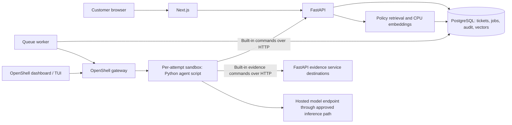

# Red Compass — OpenShell construction approval demo

Status: implemented demo; see [deployment guide](deployment.md) for deployment and validation. Target: customer demonstration on OpenShift using supplied Red Hat builds and UBI application images.

## 1. Purpose

Red Compass is a fictional construction approvals company. A customer submits a proposal; an agent running inside a fresh OpenShell sandbox interprets a deliberately unusual policy corpus, gathers supporting evidence through network tools, and records an approval or denial with cited reasons.

The demonstration showcases a small bounded agent script, OpenShell isolation and network controls, retrieval over policy documents, and the real OpenShell operator dashboard. Use existing SDKs for model access and sandbox orchestration. The rules and decisions are fictional.

## 2. Technology choices

| Concern | Proposed choice |
| --- | --- |
| Customer application | Next.js, TypeScript, Node.js, deployed on OpenShift |
| Styling | Follow the supplied Red Hat UX guidelines as closely as practical: https://ux.redhat.com/patterns/alert/style/. No Netlify library requirement; hosting remains OpenShift. |
| Business API | Python FastAPI, Pydantic schemas, generated OpenAPI |
| Agent runtime | Small Python script with a maximum of 30 model turns, built-in commands, and early exit on an accepted decision |
| Model | Configurable Anthropic Messages-compatible endpoint and model ID, accessed through the Anthropic Python SDK |
| Agent business tools | Fixed built-in commands implemented as Python functions using HTTPX to call FastAPI directly; no MCP |
| Sandbox orchestration | Official OpenShell Python SDK against the OpenShell gateway; SDK and gateway versions pinned together |
| Queue | PostgreSQL-backed jobs, claimed by a separate Python worker using database leases |
| Application and vector storage | PostgreSQL with pgvector, subject to availability in supplied builds |
| Retrieval | sentence-transformers with pgvector's SQLAlchemy integration; pre-cached `all-MiniLM-L6-v2` runs on CPU in the API server |
| Operator interface | OpenShell browser dashboard, exposed through an authenticated OpenShift Route |
| Deployment | Existing OpenShell Helm chart plus a small application chart with OpenShift Routes, Secrets, ConfigMaps, Services, and PVCs |

The script owns only the model/tool loop and termination behavior. Model access uses the Python SDK; business commands have fixed schemas and direct API mappings. There is no general-purpose coding harness, shell command execution, or MCP server.

## 3. Architecture



OpenShell provisions and governs the sandbox resources in OpenShift. The application worker requests sandboxes through OpenShell; it does not implement a second Kubernetes sandbox controller. Database access remains behind the API/retrieval service.

## 4. Customer experience

The client-facing application has three primary screens:

1. **New request:** structured construction details plus a free-text proposal.
2. **Your requests:** pending, approved, and denied requests with dates and summaries.
3. **Request details:** submitted information, progress, final explanation, and cited policy passages.

Form fields include applicant, fictional parcel ID, work type, proposed dates, dimensions, materials, colour description, intended use, demolition/groundwork details, drainage changes, and a narrative. Seeded examples let a presenter populate the form in one click. Attachments are outside the initial scope.

The interface displays business decision states separately from operational progress. A pending request can show queued, starting review, reviewing, retrying, or review interrupted. Infrastructure failures must never become business denials. Use polling initially; streaming is optional.

Use two seeded customer identities with server-enforced ownership to demonstrate “your requests.” Keep the authentication integration replaceable for the target environment.

## 5. Request and sandbox lifecycle

1. `POST /api/requests` validates the form and atomically inserts a ticket and queue job. Return HTTP 202 and a ticket ID. Support an idempotency key.
2. The worker claims a job with a renewable lease, creates an attempt record, and pins the policy corpus version and evidence snapshot.
3. Using the OpenShell SDK, it requests a sandbox from a supplied image with a fixed policy template and correlation metadata.
4. Pass non-secret context including `TICKET_ID`, `ATTEMPT_ID`, `POLICY_VERSION`, `API_BASE_URL`, and approved evidence service URLs into the sandbox environment. Ticket IDs are identifiers, not credentials.
5. Supply a short-lived credential scoped to that ticket and attempt through the supported secret/provider mechanism. Keep model credentials in the approved OpenShell provider path where supported by the supplied build.
6. Start the Python agent script with its review prompt, tool definitions, and fixed 30-turn maximum. Configure the SDK through `ANTHROPIC_BASE_URL` and `ANTHROPIC_MODEL`; requests use the Messages API and `x-api-key` authentication through the OpenShell provider.
7. The agent fetches the request, retrieves relevant policy and referenced exceptions, calls evidence tools, and invokes the decision tool.
8. FastAPI validates identity, active attempt, citation references, and payload structure before committing the decision atomically.
9. The worker observes completion, captures permitted audit artifacts, revokes attempt credentials, and deletes the sandbox after a configurable inspection period.

Start with two concurrent sandboxes, one active attempt per ticket, a five-minute review timeout, and at most one automatic retry for transient failures. All are configuration values. A reconciler handles worker restarts, expired leases, orphaned sandboxes, and cleanup. Sandbox creation uses a stable attempt identifier so a retried SDK call cannot create duplicate work.

## 6. APIs and agent tools

| Interface | Purpose |
| --- | --- |
| `POST /api/requests` | Submit and queue a customer request |
| `GET /api/requests` | List the authenticated customer's requests |
| `GET /api/requests/{id}` | Fetch owned request, progress, and decision |
| `GET /agent/requests/{id}` | Fetch the ticket authorized for this attempt |
| `POST /agent/policies/search` | Search the pinned corpus with metadata filters |
| `GET /agent/policies/{document_id}` | Fetch a full document from the pinned corpus |
| `POST /agent/requests/{id}/decision` | Record approve or deny and supporting evidence |
| `GET /agent/evidence/parcels/{parcel_id}` | Parcel facts, served at the configured evidence service destination |
| `GET /agent/evidence/heritage/{parcel_id}` | Heritage facts, served at the configured evidence service destination |
| `GET /agent/evidence/environment/{parcel_id}` | Environmental facts, served at the configured evidence service destination |

Implement `get_request`, `search_policies`, `get_policy_document`, `lookup_parcel`, `lookup_heritage`, `lookup_environment`, and `submit_decision` as built-in commands registered as model tools. The script validates tool arguments and dispatches only these named Python functions, which call their fixed FastAPI endpoints using HTTPX. The model cannot supply arbitrary URLs, credentials, Python code, or shell commands. Bind ticket and attempt identity from runtime context rather than trusting model-supplied identifiers. `submit_decision` is the main mutating command and calls the decision endpoint directly.

Evidence commands make HTTP calls from inside the sandbox to distinct FastAPI service destinations so OpenShell observes and governs the connections. Initial services return deterministic fictional records for parcels, protected structures, wildlife calendars, waterways, and local observances. They may share an implementation image. Swapping in external services changes the command adapter and network policy, not the model loop.

### Bounded review loop

An iteration is one logical model turn, including execution of its requested tools and recording their results. The script makes at most 30 model turns in an attempt. SDK transport retries are bounded separately and do not create extra reasoning turns. Track tool calls separately and cap each turn at eight calls with response-size limits and HTTP timeouts.

1. Bootstrap the request, policy manifest, precedence rules, and a semantic policy search using the proposal narrative through the same built-in API commands, before the first model turn. Every review therefore exercises the vector index; the model can refine retrieval with further searches. If bootstrap fails, report an operational failure rather than starting an uninformed review.
2. Turns 1–29 allow retrieval, evidence lookup, and `submit_decision`. Append tool results in the SDK's expected message format; return validation and tool errors as bounded tool results.
3. Stop immediately once the API accepts `submit_decision`; do not execute any remaining tools from that response or make another model call. A rejected decision is not completion.
4. Reserve turn 30 for a forced decision using the accumulated evidence: expose only `submit_decision` and force selection of that tool through the model API. No more research tools or reasoning turns are allowed. The prompt requires approve or deny, cites the available evidence, and explains any unresolved requirements. Record `termination_reason=iteration_limit` with this decision; earlier decisions record `termination_reason=early_decision`.
5. If the final turn fails to produce a valid decision because of unresolved required evidence, apply the fictional code's explicit insufficient-evidence denial rule through `submit_decision`. Mark it `decision_origin=iteration_limit_fallback`, log that the review exhausted its budget with ticket and attempt IDs, and cite the preloaded rule in the decision. The customer sees the insufficient-evidence explanation without a technical iteration-limit alert. Do not fabricate evidence or silently substitute an approval.
6. A model outage, authentication error, unavailable decision API, or exhausted wall-clock deadline is an operational failure. Leave the request pending/interrupted for the worker's retry policy. The 30-turn limit cannot guarantee a persisted decision when infrastructure is unavailable.

The loop also has a total wall-clock deadline and bounded input/output token budgets. Record turn count, tool events, token usage when available, decision origin, and termination reason. The script exits successfully only after an accepted or idempotently confirmed decision. An ambiguous decision-write timeout is resolved by reading the stored result before retrying the same payload.

Decision payload:

```json
{
  "attempt_id": "attempt-uuid",
  "decision": "approve",
  "summary": "The proposed repair qualifies under the lantern exemption.",
  "reasons": [
    {
      "explanation": "The work preserves the fixture's historic function.",
      "policy_citations": [
        {"document_id": "RC-LAN-01", "version": "1", "section": "6.1"}
      ],
      "evidence_ids": ["heritage:RC-101"]
    }
  ],
  "policy_version": "demo-2026-01"
}
```

Require at least one supported reason. Identical duplicate submissions return the existing result; conflicting or stale submissions fail with HTTP 409. The server checks references and authorization, while policy interpretation remains the agent's responsibility. Record concise explanations and tool events rather than private model reasoning.

## 7. Policy retrieval

Author policies as versioned Markdown with stable document and section IDs. Include effective dates, jurisdiction, precedence, amendment links, and explicit cross-references. A Kubernetes ingestion Job uses the existing retrieval library to split by section, generate embeddings, and populate pgvector. Preserve headings and source metadata in every chunk.

Search combines semantic retrieval with exact policy-ID/term lookup. The agent must retrieve the precedence rules, fetch referenced exceptions, and inspect full documents when chunks are insufficient. A small policy manifest is included in the review prompt so retrieval cannot silently omit entire policy categories. Pin the corpus to the ticket attempt; edits produce a new version.

Pre-cache `all-MiniLM-L6-v2` in the API image, pin its revision, and load it in CPU mode for ingestion and query embeddings. No runtime model download or external embedding endpoint is required.

## 8. Fictional policy design

The goal is natural-language interpretation across obscure exceptions and outside evidence. No finite ruleset makes an LLM mathematically necessary; the demo should demonstrate why encoding these documents as bespoke branching logic would be cumbersome.

Create approximately 15–20 short documents across a base code, heritage annex, environmental code, council circulars, amendments, and worked precedents. Each seeded case must have a defensible expected outcome.

Example interactions:

| Rule | Complication |
| --- | --- |
| The Listening Wall Ordinance | A wall facing an old bell route counts as a frontage even if it faces a rear garden. Parcel records identify the route. |
| The Borrowed Blue Circular | “Blue” is classified by its appearance after rain, except replacement joinery matching an archived municipal sample. A marketing colour name is insufficient evidence. |
| The Dormant Stair Exemption | Repairs may preserve an existing stair, but returning a ceremonial stair to everyday access changes its function and removes the exemption. |
| The Third Silence Restriction | Groundworks are barred during the third local observance period, unless they remedy an immediate drainage failure and leave no new permanent footprint. |
| The Lantern Keeper Amendment | Heritage fixtures may be repaired with modern internals if outward form and historic function survive. A later habitat restriction can still prohibit the work dates. |
| The Invisible Extension Test | A structure invisible from the road can still count as an extension if it changes the public silhouette reflected in a listed canal. |
| The Reversible Works Exception | Reversible construction is exempt only when removal restores the former use without additional excavation. |

Define explicit precedence: applicable later amendments override named clauses; narrowly scoped exceptions override general rules only within their stated scope; unresolved material conflicts or missing required evidence produce denial with a specific explanation. Do not use unsupported arbitrary arithmetic as the main source of complexity.

Seed at least six cases: clear approval, clear denial, approval through a cross-document exception, denial through a later override, ambiguous narrative resolved by evidence, and missing evidence. Add a malicious proposal asking the agent to ignore policy and contact a forbidden destination.

## 9. OpenShell demonstration and permissions

Use the actual operator dashboard supplied with OpenShell. The presenter should correlate a ticket with its sandbox, inspect lifecycle and logs, and show allowed and denied network activity where exposed by that build. The launcher exposes the browser dashboard through an authenticated OpenShift Route.

Sandbox policy permits only required business services, evidence services, DNS, and the configured model path. Deny access to the Kubernetes API, cloud metadata, databases, other tickets, operator interfaces, and arbitrary internet destinations. The agent script exposes only its fixed built-in commands; OpenShell remains the runtime boundary.

Include an operator-run blocked-egress probe alongside the normal business review, so a successful security demonstration does not depend on the model choosing to obey a malicious instruction. The agent must not be able to change its sandbox policy.

## 10. OpenShift and supplied builds

Deploy application services into `red-compass`, the control plane into `openshell`, and sandbox resources into OpenShell-managed workspace namespaces as supported by the pinned build. Use OpenShift Routes for the customer application and approved operator access. Keep agent tools and storage internal.

Use the upstream Helm deployment path with supplied image overrides. No Docker daemon, Podman service, or nested container runtime is part of the application design. Reuse OpenShell's controller integration, RBAC, and sandbox provisioning.

The current upstream OpenShift guide specifies OpenShift 4.19+ and requires kernel support for Landlock and nested seccomp user notification, plus enforced ingress/egress NetworkPolicy. Validate these against the supplied release and cluster before implementation. See [OpenShell on OpenShift](https://docs.nvidia.com/openshell/kubernetes/openshift). This is a compatibility gate, not a reason to request a privileged SCC.

All deployed images, including gateway, supervisor, init/helpers, controller dependencies, harness, frontend, API, worker, database/vector extension, and ingestion jobs, must satisfy the user's Red Hat build requirement. Maintain an image inventory with registry, digest, architecture, and version. Do not silently fall back to upstream images. UBI-based packaging and Red Hat-supported product builds are different claims; confirm which applies to each supplied artifact.

Application containers support assigned non-root UIDs, restricted SCCs, dropped capabilities, mounted CA bundles, configured resource limits, probes, and writable paths on volumes. Do not mount Kubernetes service account tokens into agent workloads unless a verified platform requirement demands it. The agent receives no cluster-management permissions.

## 11. Acceptance and implementation order

1. **Compatibility spike:** confirm image inventory, OpenShift/kernel/runtime compatibility, Python SDK sandbox creation, real dashboard access, Anthropic SDK tool calling against the configured model, and authenticated direct API calls from the sandbox. Create and delete one sandbox on the target cluster.
2. **Vertical slice:** submit one request, claim it, launch the Python agent script, retrieve a policy, record a decision, and display it in Your requests.
3. **Policy demo:** ingest the complete corpus, add deterministic evidence services and all seeded cases, and show cited cross-document reasoning.
4. **Operational demo:** verify retries, idempotency, worker recovery, cleanup, denied network access, ticket isolation, and operator inspection.

Acceptance requires both approval and denial, traceable policy/evidence citations, separate sandboxes for concurrent requests, rejection of cross-ticket/stale decisions, pending status on infrastructure failure, and visible enforcement of an unauthorized network call. Verify early exit, the 30-turn maximum, forced final decision, labeled insufficient-evidence fallback, and no tool execution after an accepted decision. Record model and embedding versions with the corpus and script configuration for repeatable runs. Target a normal demonstration review within two minutes after the compatibility spike establishes realistic model latency.

## 12. Configuration and operating scope

Set `ANTHROPIC_API_KEY`, `ANTHROPIC_BASE_URL`, and `ANTHROPIC_MODEL` for an endpoint implementing the Anthropic Messages API, including tool calling and forced tool selection. The launcher derives the model provider's allowed hostname and port from that URL. API keys belong in the local, git-ignored `.env` or a secret manager, and are provisioned into the gateway credential store.

The deployment uses the active `oc` context. Routes and dashboard OAuth callbacks are derived from the target cluster. The published SDK and Helm chart must be compatible with the declared ODH images. See [deployment guide](deployment.md) for installation requirements and verification.

The demo includes public CPU embeddings, fictional policy documents and evidence, and two seeded customer identities. The model interprets policy; a valid structured response and citations do not establish that its interpretation is correct. This is a demonstration workflow, not a production construction-permitting system.

## 13. Execution traceability

MLflow provides one review trace per ticket attempt, correlated by ticket ID, attempt ID, policy version and sandbox name. Child spans cover model calls, initial and model-selected policy retrieval, evidence lookups, decision submission and fallback. Record durations, input/output token counts, requested tool names, public policy/evidence identifiers and final decision origin. Operational exceptions carry their exception type, not raw exception text.

Use the Python SDK's explicit span APIs with allowlisted payloads. Do not autolog raw conversations or tool bodies: applicant text, credentials and private model reasoning must not enter traces. Tracing is best effort and does not alter approval, denial, retry or review-budget semantics. Traces are exported on normal completion or handled failure; abrupt sandbox termination may lose a trace. This feature does not evaluate decision correctness.

Deploy the upstream MLflow server on UBI with persistent storage and an OpenShift OAuth-protected operator Route. Give sandbox Python processes access only to its internal tracking endpoint through OpenShell policy; restrict server ingress by namespace. Keep this observability path separate from the customer UI and the actual OpenShell dashboard.
